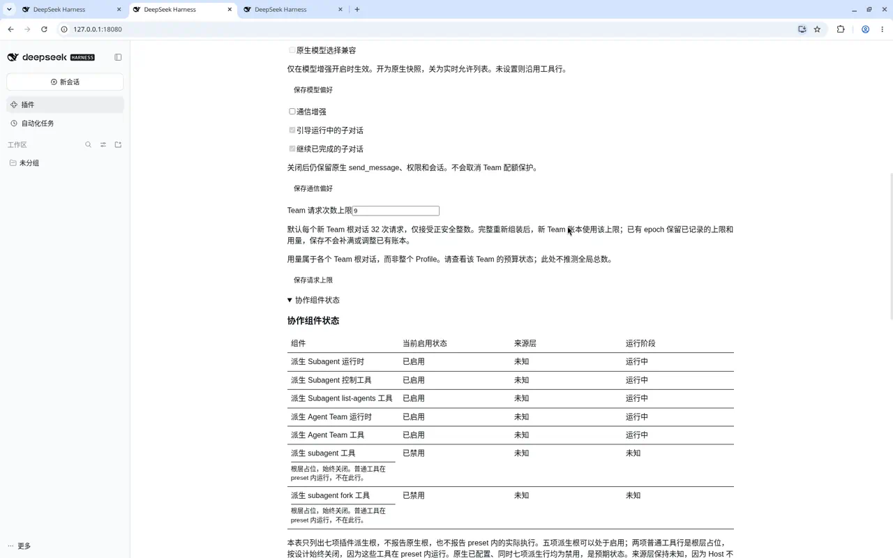

# DSH Native Collab · 原生协作增强

让 DSH 的 Agent Team 更灵活：灵活选择模型，增强父子对话通信。

Flexible Agent Teams and model selection for DSH, with enhanced communication between parent and child conversations.

这是基于 DeepSeek Harness 原生协作模块修改的**非官方社区插件**，不是 DeepSeek 官方发行版，也不是另一个聊天客户端。

**当前版本：0.2.1，社区预发布。预期兼容 DSH 0.2.1 系列，从 `0.2.1-rc.1` 起。**

[English](README.en.md) · [安装与使用](docs/INSTALL.md) · [常见问题](docs/FAQ.md) · [更新日志](CHANGELOG.md)

## 它解决什么问题

- **灵活选择模型**：可以保留原生的模型选择快照，也可以按当前宿主允许的模型列表选择。
- **增强父子对话通信**：支持运行中引导、完成后续聊，仍受原有权限和会话规则约束。
- **Team 请求上限**：给每个 Team 限制请求次数，默认 32 次；记录会保留，重启不会把用量清零。
- **切换前看清楚**：先列出哪些组件、哪些 Agent 配置会被替换，确认后才保存；不是装上就接管。

**不另增一套并行工具。**本插件对原版协作工具作兼容性替换，在保留原有协作功能的基础上提供增强；同时更新模型看到的工具说明和使用提示词，尽可能减少重复工具定义与说明带来的额外上下文开销。

这里的“原生”指代码来自 DSH 原生协作模块，**不表示本插件由官方提供**。请求上限计的是请求次数，不是人民币金额，也不是 token 上限。

## 启动覆盖与还原

**本插件会通过启动配置覆盖，切换部分官方协作组件及 Agent 预设中的工具，使用本项目的增强实现。**它不修改 DSH 官方安装文件；仅安装不会切换，需在插件自己的总开关中查看并确认变更，完整重启后才生效。

**需要还原时，关闭本插件自己的总开关、确认保存，再完整重启，即可切回官方原生协作组件。**不要仅关闭 DSH 插件管理器中的单个组件，也不要直接卸载。

切回原生不等于恢复安装前的全部配置，具体区别如下：

1. **关闭插件，不等于还原安装前的样子。**关闭总开关会固定启用五个原生协作组件，即使它们安装前原本禁用；同时清除本插件受管偏好。
2. **部分配置副本会留下来。**启用时会把相关 Agent 预设（preset）的完整配置复制到当前 Profile。关闭后只换回原生模块，不删除副本；以后升级 DSH，可能需要重新核对这些配置。
3. **卸载前要先关闭插件自己的总开关。**不能直接点 DSH 的 Remove；否则可能留下引用已删除插件的配置，导致会话无法启动。插件不会拦截官方 Remove。

已有会话和 Team 用量记录不会被本插件删除。改变请求上限只影响之后新建的 Team，旧 Team 继续使用原上限与已用次数。

## 怎么安装

先看[完整安装说明](docs/INSTALL.md)：它包含备份、原生 Team 组件准备，以及本插件要求的关闭热重载步骤。

在版本和前提都符合后，直接按包名安装（`web` 换成你的 Profile 名称）：

```sh
dsh plugin --profile web add @sieuno/dsh-native-collab
```

也可在 DSH 的“添加插件”页面输入 `@sieuno/dsh-native-collab`。GitHub Release 提供相同内容的 TGZ 安装包，Windows、macOS 和 Linux 均使用这一格式，不需要手工解压。Source code ZIP 不是安装包。

**旧版 0.2.0 用户注意：**旧包名为 `@dsh-native-collab/derived`，与新包不是同一安装项。请先用旧插件自己的总开关切回原生、确认保存并停止相关 Host/Agent，再卸载旧包，然后安装新包。不要同时安装，完整步骤见[升级说明](docs/INSTALL.md#从旧版-020-升级)。以后新包的同名版本可以正常更新。

然后按安装说明启动对应 Profile，在左侧“插件”里打开本插件，用**插件自己的总开关**查看变更并确认，再停止相关 Host/Agent、完整重启。

**装上 ≠ 已切换；保存成功 ≠ 当前 Agent 已生效。**不要手工逐个打开那七个派生组件开关；两个普通工具占位行本来就应保持关闭。

## 日常使用



图中的请求上限 9 是示例设置，默认值为 32。

在插件设置页分别保存模型、通信和请求上限偏好，然后完整重启该 Profile。界面会分开显示“已保存的偏好”和“启动时观察到的值”，两者不同通常表示还没重启。

“原生模型选择兼容”仅在模型增强开启时生效：开启使用原生快照，关闭使用当前允许列表；未设置时沿用工具行配置。通信增强关闭不代表取消原生消息功能，也不会移除 Team 请求上限。

## 卸载流程

**先关闭总开关 → 确认写入成功 → 停止相关 Host/Agent → 再卸载 → 重启核对。**

这里的关闭是固定切回五个原生组件，**不恢复安装前的启停状态**。插件不清空整份 patch，也不会替你停止任务。

卸载命令（以 `web` 为例）：

```sh
dsh plugin --profile web remove @sieuno/dsh-native-collab
```

如果关闭被阻止，先看[排错说明](docs/FAQ.md)，不要跳过这一步强行卸载。

## 兼容性与已知问题

适用 DSH `>=0.2.1-rc.1 <0.2.2-0`，需要 Node `>=22.19.0`。

窄窗口下，确认表里的长操作名可能需要横向滚动查看。

开发者可查看[开发与测试说明](https://github.com/Sieuno/dsh-native-collab/blob/main/CONTRIBUTING.md)。

## 来源与许可

基于 [DeepSeek Harness](https://github.com/deepseek-ai/deepseek-harness) 的 `dsh-v0.2.1-rc.2` 派生，遵循 [MIT 许可](LICENSE)，保留上游版权和 NOTICE。详见[来源](UPSTREAM.md)与[第三方声明](THIRD_PARTY_NOTICES.md)。

[下载 v0.2.1](https://github.com/Sieuno/dsh-native-collab/releases/tag/v0.2.1) · [反馈问题](https://github.com/Sieuno/dsh-native-collab/issues)
